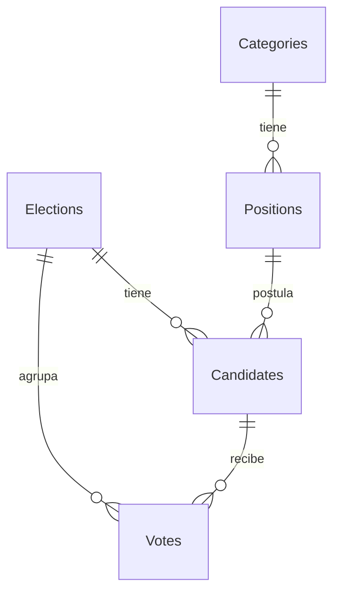

# feat: Votación electrónica para elecciones de directivas (React + Google Apps Script + Sheets)

## Contexto

La iglesia elige tres directivas (Caballeros, Damas, Jóvenes), cada una con 4 cargos (Presidente, Vicepresidente, Secretario, Tesorero). Votarán unas 200 personas en un máximo de 10 tablets, y el staff vigila todo desde un panel central. El voto es anónimo. Muchos votantes son personas mayores, así que la estación de votación tiene que ser muy sencilla. Todo debe ser gratuito: React + Vite servido por Google Apps Script (HtmlService + `google.script.run`, sin CORS), con Google Sheets como base de datos.

**Decisiones del usuario (sesión de planificación):**
- **Todos votan en las 3 directivas**, en **una sola página** separada por directiva. Una papeleta = 12 selecciones (3 directivas × 4 cargos).
- **Control físico del staff:** el staff verifica a cada persona y desbloquea la estación. No hay códigos ni hoja `Participation`.
- **Sin login de administrador**: "lo más sencillo posible, proyecto rápido". Por eso **no hay** `AdminUsers`, roles ni `AdminLoginPage`.

**Decisiones derivadas (cambiables al aprobar):**
- **Protección mínima del panel sin login:** un **enlace secreto** `…/exec?view=admin&key=XXXX`. `setupDatabase()` genera la llave y la guarda en Script Properties; el staff la guarda como marcador. No hay pantalla de login, pero un dispositivo de votación o alguien que solo tenga el enlace normal no puede ver resultados ni ejecutar acciones de staff.
- **Desbloqueo de la estación:** secuencia táctil secreta + **PIN de staff de 4 dígitos**, que se verifica en el servidor (lo pide el prompt original). El staff también puede desbloquear la estación de forma remota desde el panel.
- **Los 12 cargos son obligatorios** (según el prompt). Si se quiere permitir que alguien no vote en una directiva, se cambia una sola regla de validación.

## Arquitectura

```
Tablet (kiosko)  ─┐                         ┌─ Google Sheets (BD)
Tablet ×10       ─┼─ google.script.run ──►  Apps Script  ─┤  Script Properties (llave admin, hash PIN)
Panel staff      ─┘   (misma URL /exec)     (LockService)  └─ CacheService (heartbeats, rate-limit)
```

- Hay **un solo bundle React** (`vite-plugin-singlefile` → `index.html`), servido con `HtmlService.createHtmlOutputFromFile('Index')`. No se usa `createTemplateFromFile` porque los scriptlets `<? ?>` romperían el JS minificado.
- La vista se elige en el cliente con `google.script.url.getLocation()`: `view=admin&key=…` abre el panel y cualquier otro valor abre el kiosko. Dentro de cada vista se navega con `HashRouter`, porque `BrowserRouter` no funciona en el iframe.
- **El servidor expone solo 3 funciones públicas.** Cualquier función global sin `_` final se puede llamar desde el navegador, así que toda la lógica interna termina en `_`:
  - `kioskApi(action, deviceToken, payload)`
  - `adminApi(action, adminKey, payload)`
  - `setupDatabase()`: idempotente y **no destructiva**. Solo crea hojas o encabezados que falten y nunca toca datos, así que es segura aunque se invoque desde el cliente.
- Las funciones del prompt (`registerVote`, `getResults`, `resetDevice`, …) existen como `registerVote_()`, etc., y se llaman a través de un dispatcher con una tabla de acciones permitidas.
- `doGet()` llama a `.addMetaTag('viewport', …)` y `.setTitle(…)`. Las meta tags escritas directamente en el HTML se ignoran.
- Las fechas viajan como ISO string, porque `google.script.run` no acepta objetos `Date`.

## Modelo de datos (Google Sheets)



| Hoja | Columnas |
|---|---|
| `Elections` | id, name, description, status (`DRAFT`/`OPEN`/`PAUSED`/`CLOSED`), created_at, opened_at, closed_at |
| `Categories` | id (`CAB`,`DAM`,`JOV`), name, sort |
| `Positions` | id (`CAB-PRES`…), name, category_id, sort, 12 filas sembradas |
| `Candidates` | id, election_id, name, category_id, position_id, photo_url (opcional), active, created_at |
| `Votes` | vote_id, **ballot_id**, election_id, category_id, position_id, candidate_id, created_at (**solo fecha**) |
| `Devices` | id, name, status (`READY`/`VOTING`/`LOCKED`/`DISABLED`), token_hash, created_at, updated_at |
| `AuditLog` | id, at, actor (`staff`/`device:<id>`/`system`), action, detail |

- **Script Properties:** `SPREADSHEET_ID`, `ADMIN_KEY`, `STAFF_PIN_HASH` + `PIN_SALT`, `ACTIVE_ELECTION_ID`, `SHOW_LIVE_RESULTS`.
- **CacheService:** `hb_<deviceId>` (última actividad, para no escribir en la hoja en cada poll), `pinfail_<deviceId>` (rate limit).

**Anonimato (prioridad):**
- `Votes` no guarda dispositivo, hora exacta ni ningún dato del votante.
- Cada papeleta (12 filas contiguas) se inserta en una **posición aleatoria** de la hoja con `insertRowsBefore`. Así, el orden de las filas no se puede cruzar con el `AuditLog` ("estación 3 desbloqueada 10:02").
- El `AuditLog` registra "papeleta registrada en estación X", pero **nunca** el `ballot_id` ni las selecciones.

## Flujos clave

### Estación de votación (kiosko)

1. **Primer uso:** la tablet no tiene token. Se muestra la pantalla "Registrar estación": nombre ("Mesa 1") + PIN de staff. El servidor crea el dispositivo y devuelve un token aleatorio. La tablet guarda el token en `localStorage` y el servidor guarda solo su hash SHA-256. Si `localStorage` se pierde (Safari lo puede borrar), se vuelve a registrar y el panel permite deshabilitar la entrada vieja.
2. **El estado lo decide siempre el servidor**, no el cliente. Recargar la página con la estación `LOCKED` vuelve a la pantalla bloqueada, así que no se puede saltar el bloqueo recargando.
3. **Flujo de votación:**
   - `LOCKED`: pantalla de agradecimiento / "Espere al staff".
   - Secuencia táctil + PIN pasa la estación a `READY`: pantalla de bienvenida con un botón gigante "Comenzar a votar".
   - Al tocar "Comenzar" pasa a `VOTING`.
   - **Página única** con las 3 secciones (Caballeros / Damas / Jóvenes), cada una con sus 4 cargos.
   - Pantalla **Revisar**: 12 selecciones con botones "Cambiar" / "Confirmar voto".
   - Envío, pantalla de **¡Voto registrado!** y vuelta a `LOCKED`.
4. **UX para personas mayores:**
   - Texto base de 22–24px, alto contraste y tarjetas de candidato de al menos 72px de alto con iniciales grandes (o foto si hay `photo_url`).
   - El candidato seleccionado muestra un check verde grande y un borde verde. Volver a tocar el mismo cargo cambia la selección (estilo radio).
   - Cabecera fija con las 3 directivas y su progreso (✓ cuando están completas), que también sirven para saltar a cada sección. Barra inferior fija: "8 de 12 listos" + botón "Revisar mi voto".
   - Si tocan el botón con cargos pendientes, la página se desplaza al primer cargo pendiente y lo resalta suavemente. No se usan mensajes de error agresivos.
   - Inactividad de 3 minutos: aviso "¿Sigue ahí?". A los 4 minutos se limpian las selecciones y se vuelve a la bienvenida. No se registra nada y la estación sigue habilitada para esa persona.
5. **Envío idempotente y reintentos:**
   - El cliente genera `ballot_id = crypto.randomUUID()` **antes** de enviar y guarda la papeleta pendiente en `localStorage`.
   - Si la red falla, se muestra "Enviando… no cierre" y se reintenta con backoff usando **el mismo** `ballot_id`.
   - El éxito solo se muestra cuando el servidor lo confirma. La papeleta pendiente se borra al confirmar.
6. **Polling:** en `LOCKED`, cada 5 s (para detectar el desbloqueo remoto). En `READY`/`VOTING`, cada 15 s (para detectar `DISABLED` o elección cerrada). Si la estación está `DISABLED` o la elección no está `OPEN`, se muestra "Estación fuera de servicio" / "Votación cerrada".

### Desbloqueo con comando táctil (`useUnlockSequence`)

- **Secuencia:** pantalla dividida en una cuadrícula invisible de 3×3. Zonas: ↖ → ↘ → ↗ → ↙ → centro, definidas en `utils/unlockConfig.js`. No hay ningún feedback visual.
- **Límites:** máximo 1.5 s entre toques y 8 s en total. Un toque erróneo reinicia la secuencia en silencio. Tras 3 secuencias fallidas hay una espera de 30 s, durante la cual se ignoran los toques.
- **PIN:** si la secuencia es correcta, aparece un teclado de PIN con dígitos grandes. `kioskApi('unlock', token, {pin})` verifica el hash en el servidor y bloquea 5 minutos por dispositivo tras 5 PIN fallidos (CacheService). Luego pasa la estación a `READY` y registra el evento en el audit log.
- **Al desbloquear, el cliente:** limpia selecciones, mensajes y papeleta pendiente (solo si ya fue confirmada), y vuelve a la bienvenida.
- **Ninguna acción de reinicio toca la hoja `Votes`.** La secuencia solo evita reinicios accidentales; la autorización real está en el servidor.

### `registerVote_` (operación crítica)

Toda la operación corre dentro de `LockService.getScriptLock().waitLock(15000)`, en este orden:

1. Si el `ballot_id` ya existe (`createTextFinder(...).matchEntireCell(true)` sobre la columna `ballot_id`), devolver `{ok:true, duplicate:true}`. Así funcionan los reintentos.
2. Validar el token del dispositivo (por hash). El dispositivo debe estar `READY` o `VOTING`.
3. La elección activa debe estar `OPEN`.
4. Validar la papeleta: exactamente 12 selecciones, cada `position_id` una sola vez, y cada candidato activo y perteneciente a esa elección, categoría y cargo.
5. Escribir las 12 filas con **un solo `setValues`**, que se aplica completo o falla completo, en una posición aleatoria.
6. Pasar el dispositivo a `LOCKED`, llamar a `SpreadsheetApp.flush()`, escribir en el audit log y liberar el lock.

**Recuperación:** `getResults_` cuenta solo las papeletas con sus 12 filas válidas. Una función de integridad reporta en el panel cualquier `ballot_id` incompleto para revisión manual. Esas filas nunca se borran automáticamente.

### Panel del staff (`?view=admin&key=…`)

- **Polling y layout:** una sola llamada `adminApi('dashboard')` cada 4 s, que se pausa con `document.visibilityState === 'hidden'`. Layout con sidebar y dos colores distintos a los del kiosko.
- **Dashboard:**
  - Estado de la elección y botones Abrir / Pausar / Cerrar, con confirmación.
  - Total de papeletas y estaciones activas.
  - Tabla de estaciones con estado, nombre, última actividad y el indicador "votando ahora".
  - Actividad reciente (últimos 15 eventos del audit log) y alerta de integridad si hubiera papeletas incompletas.
- **Candidatos:** CRUD agrupado por directiva y cargo. Crear, editar y eliminar solo se permite si la elección está `DRAFT`. Con la elección `OPEN`/`CLOSED`, todo queda en solo lectura, lo cual se valida **también en el servidor**.
- **Estaciones:** Habilitar (`READY`), Bloquear (`LOCKED`), Deshabilitar (`DISABLED`), Reiniciar (vuelve a `READY` y la tablet limpia su estado en el siguiente poll), y Ver actividad (audit log filtrado).
- **Resultados:**
  - Por directiva y cargo: votos y % por candidato, con barras hechas con Tailwind (sin librería de gráficos, para un bundle más liviano) y el ganador destacado.
  - El servidor los **oculta** mientras la elección no esté `CLOSED`, salvo que se active `SHOW_LIVE_RESULTS` en Ajustes.
  - Con la elección abierta solo se ve la participación (número de papeletas).
- **Exportar CSV:**
  - Se genera en el cliente (Blob + `<a download>`; el sandbox del iframe incluye `allow-downloads`). El CSV lleva BOM UTF-8 para que Excel muestre bien las tildes.
  - Alternativa por si falla en iPad: `adminApi('exportToDrive')` crea el CSV en Drive y devuelve el link.
- **Ajustes:**
  - Nombre y descripción de la elección.
  - "Nueva elección": crea un nuevo `election_id`, pasa la anterior a solo lectura y **no borra nada**. Es el "reiniciar estado operativo".
  - Cambiar el PIN de staff.
  - Activar o desactivar los resultados en vivo.

## Estructura del proyecto

Nueva carpeta: `C:\Users\jgome\Documents\developer\votacion-iglesia\`. Se siguen las convenciones de `boda-app`: React 19, Tailwind 4 y Vitest.

```
votacion-iglesia/
  package.json            # react, react-dom, react-router, lucide-react; dev: vite, @vitejs/plugin-react,
                          # tailwindcss, @tailwindcss/vite, vite-plugin-singlefile, vitest
  vite.config.js          # singlefile + tailwind
  scripts/copy-to-gas.js  # dist/index.html → apps-script/Index.html
  src/
    main.jsx, App.jsx     # elige vista kiosk/admin vía getLocation; HashRouter
    services/googleScript.js   # promisifica google.script.run; en DEV usa mockBackend
    services/mockBackend.js    # backend en memoria (latencia + fallos simulados) para `npm run dev`
    services/votingService.js, deviceService.js, adminService.js
    hooks/useUnlockSequence.js, usePolling.js, useIdleTimer.js, useDeviceStatus.js
    context/KioskContext.jsx, AdminContext.jsx
    utils/ballot.js (validación compartida), results.js, csv.js, unlockConfig.js
    components/voting/  (DirectivaSection, PositionBlock, CandidateCard, ProgressBar, ReviewList, PinPad, LockScreen)
    components/admin/   (Sidebar, DeviceTable, CandidateForm, ElectionControls)
    components/dashboard/ (StatCard, ResultBars, ActivityFeed)
    components/shared/  (Button, Modal, Spinner, ConfirmDialog)
    pages/VotingPage.jsx, DashboardPage.jsx, CandidatesPage.jsx, DevicesPage.jsx, ResultsPage.jsx, SettingsPage.jsx
  apps-script/
    appsscript.json       # V8, webapp: executeAs USER_DEPLOYING, access ANYONE_ANONYMOUS
    Code.gs (doGet, kioskApi, adminApi, dispatch), Database.gs (setupDatabase, helpers de lectura/escritura),
    Elections.gs, Candidates.gs, Voting.gs, Devices.gs, Results.gs, Security.gs (hash, tokens, PIN, adminKey),
    Audit.gs, Utils.gs, SeedData.gs (seedTestData: elección de prueba + 2–3 candidatos por cargo)
  .clasp.json             # rootDir: apps-script
  README.md               # instalación, despliegue, día de la elección, guía de administración
  docs/plans/2026-11-24-feat-votacion-electronica-iglesia-plan.md   # copia de este plan
```

## Fases de implementación

Al final de cada fase se verifica la coherencia con las anteriores.

1. **Fase 1: Arquitectura y Sheets.** Scaffold de Vite, `appsscript.json` y `.clasp.json`. `Database.gs` + `setupDatabase()`: crea las hojas y encabezados, siembra `Categories`/`Positions`, y genera `ADMIN_KEY` y el PIN inicial (los muestra con `Logger.log`, visibles en el registro de ejecución del editor). `SeedData.gs`.
2. **Fase 2: Backend.** Dispatchers con lista blanca de acciones, `Security.gs` (SHA-256 con `Utilities.computeDigest` y conversión de bytes con signo a hex, `Utilities.getUuid()` para tokens), `registerVote_` con lock e idempotencia, devices, elections, candidates, results y audit.
3. **Fase 3: Frontend de votación.** `googleScript.js` + `mockBackend.js`, página única de 3 directivas, revisión, envío con reintentos, pantallas de estado.
4. **Fase 4: Panel admin.** Layout con sidebar, dashboard con polling, CRUD de candidatos, controles de la elección.
5. **Fase 5: Seguridad y dispositivos.** Registro de estaciones, `useUnlockSequence` + PinPad, rate limiting, desbloqueo y reinicio remotos, heartbeat en CacheService.
6. **Fase 6: Resultados y exportación.** Agregación, ocultamiento en el servidor, barras, CSV y alternativa con Drive, alerta de integridad.
7. **Fase 7: Pruebas y despliegue.** Vitest, `runSmokeTest()` en el editor, README completo, prueba con 2–3 tablets reales.

## Limitaciones honestas de Google Sheets (para el README)

- **El dueño de la cuenta Google puede editar la hoja a mano.** Esto no se puede impedir técnicamente. Mitigaciones:
  - Usar una cuenta Google dedicada a la elección y no compartir la hoja.
  - El "Historial de versiones" de Sheets queda como registro de auditoría de cualquier edición manual.
  - Exportar y anunciar el CSV al cerrar.
- **Cuotas:** con "Ejecutar como yo", todas las llamadas cuentan para el límite de 30 ejecuciones simultáneas del dueño. 10 tablets más el panel, con llamadas cortas (menos de 1 s), dejan margen de sobra. Cada llamada tarda entre 0.4 y 1.5 s; la UI siempre muestra un spinner.
- **Google muestra un banner arriba** ("creada por un usuario de Google Apps Script") en cuentas gratuitas. Es solo estético.
- **`localStorage` en Safari/iPad puede borrarse.** No afecta a los votos: el estado real vive en el servidor y, como mucho, hay que volver a registrar la estación.
- **Sin login de admin, el enlace secreto es la única barrera.** Si se filtra, se genera una nueva llave en Script Properties.

## Criterios de aceptación

- [ ] Una papeleta solo se registra si tiene 12 selecciones válidas; se rechaza en el cliente **y** en el servidor.
- [ ] Reenviar el mismo `ballot_id` (por un reintento o un doble toque) nunca duplica votos.
- [ ] Después de votar, la estación queda `LOCKED` en el servidor. Recargar la página no permite volver a votar.
- [ ] El desbloqueo requiere la secuencia (con tiempo límite, intentos limitados y sin feedback visual) **y** el PIN validado en el servidor.
- [ ] Ninguna acción de reinicio, desbloqueo o "nueva elección" modifica ni borra filas de `Votes`.
- [ ] `Votes` no contiene ningún dato del dispositivo ni del votante, y las papeletas no quedan en orden cronológico.
- [ ] El kiosko nunca recibe resultados: `kioskApi` no tiene ninguna acción de resultados y `adminApi` exige `ADMIN_KEY`.
- [ ] Los resultados quedan ocultos en el servidor hasta `CLOSED`, salvo que el staff active los resultados en vivo.
- [ ] No se puede votar con la elección `DRAFT`/`PAUSED`/`CLOSED`.
- [ ] Los candidatos no se pueden editar ni eliminar con la elección `OPEN` o `CLOSED`.
- [ ] El kiosko se usa cómodamente en una tablet de 10" con texto grande; una persona mayor completa la papeleta sin ayuda.
- [ ] El CSV abre correctamente en Excel/Sheets con tildes.

## Verificación

1. **Local:** `npm run dev`, con `mockBackend` simulando el servidor. Se prueban el flujo completo del kiosko, el panel en `/#/admin`, fallos de red simulados (reintento sin duplicar) y la secuencia más el PIN.
2. **Unit tests (`npm test`, Vitest):**
   - Detector de secuencia: orden, tiempo límite, espera tras fallos.
   - `utils/ballot.js`: papeleta incompleta, cargo duplicado, candidato de otra categoría.
   - `utils/results.js`: excluye papeletas incompletas.
   - `utils/csv.js`: BOM, escape de comas y comillas.
3. **Apps Script:**
   - `npm run build:gas && clasp push`.
   - En el editor, ejecutar `setupDatabase()`, luego `seedTestData()` y luego `runSmokeTest()`. El smoke test usa la elección de prueba y verifica voto válido, reenvío duplicado, candidato inválido, voto con la elección cerrada y dispositivo `LOCKED`.
   - Implementar como aplicación web (ejecutar como "Yo", acceso "Cualquier usuario").
4. **Ensayo general con 2–3 tablets reales:**
   - Registrar las estaciones y votar en paralelo desde varias tablets al mismo tiempo (comprobación del LockService).
   - Cortar el Wi-Fi a mitad del envío y confirmar que no hay duplicados.
   - Desbloqueo remoto, cerrar la elección y verificar resultados y CSV.
   - Al terminar, usar "Nueva elección" para empezar limpio. Los votos de prueba quedan aislados por `election_id`.
5. **README, día de la elección:**
   - Fijar la app en la tablet: "Fijar pantalla" en Android o "Acceso guiado" en iPad.
   - Desactivar el bloqueo automático de pantalla y mantener las tablets cargando.
   - Tener un hotspot de respaldo.
   - Checklist de apertura y cierre.

## Notas de implementación (2026-11-24)

Implementado según el plan, con estos ajustes:

- **Emulador de Apps Script** (`src/emulator/`): el código real de `apps-script/*.gs` corre en el navegador (`npm run dev`) y en Vitest sobre una hoja de cálculo emulada. Reemplaza al `mockBackend` duplicado y a `runSmokeTest()`: las pruebas del servidor viven en `tests/server.test.js`. En el editor queda `diagnostico()`, de solo lectura.
- **Funciones de editor protegidas** con `assertOwner_()` (`Session.getActiveUser()` vs `getEffectiveUser()`), en lugar de confiar en que sean inofensivas.
- **Datos de ejemplo:** acción `seedTestData` del panel (requiere llave), en `Candidates.gs`. No hay un `SeedData.gs` público.
- **Exportación alternativa:** hoja "Resultados" en el mismo documento, en lugar de un CSV en Drive, para no pedir permiso total sobre Drive.
- **PIN** fijo de 4 dígitos (el teclado de la estación es de 4).
- **Polling** de la estación cada 5 s también en la bienvenida (detecta rápido un bloqueo o cierre remoto); cada 15 s solo mientras se vota.
- **Verificación:** 69 tests de Vitest, un e2e con Playwright de todo el flujo (registro → desbloqueo → voto → bloqueo → resultados) y un e2e con un 60 % de fallos de red simulados que confirma exactamente 12 filas por papeleta.

## Cambios solicitados (2026-11-24, segunda iteración)

- **Sin PIN:** el registro de estaciones pide solo un nombre. Se eliminaron el PIN de staff, el teclado PinPad y el cambio de PIN en Ajustes.
- **Desbloqueo:** 3 toques seguidos en la esquina superior izquierda (160 px, menos de 0,7 s entre toques), en `src/utils/unlockSequence.js`.
- **Nueva vista `#/pantalla`:** resultados en grande sin sidebar, para proyector. Usa la misma llave del panel. `App.jsx` copia el hash de `google.script.url.getLocation()` al iframe para que el enlace directo funcione en Apps Script. El dashboard incluye `appUrl` para abrirla en otra pestaña.

## Cargos por orden de votos (2026-11-24)

- **Votaciones:** por directiva hay 2, Presidencia (1.º Presidente, 2.º Vicepresidente) y Secretaría (1.º Secretario, 2.º Tesorero). Cada votante marca 1 candidato por votación: 6 selecciones por papeleta.
- **Datos:** `Positions` tiene la columna nueva `roles` ("Presidente|Vicepresidente"). `assignSeats_` reparte los cargos por orden de votos y marca un empate por cargo; `seatLabel_` alimenta la exportación.
- **Mínimo de candidatos:** para abrir la votación, cada votación necesita al menos 2 candidatos activos.
- **Migración:** `setupDatabase` migra la estructura anterior de 4 cargos (VICE→PRES, TESO→SECR, conservando candidatos) solo si no hay votos que la usen. Nunca toca la hoja Votes.

